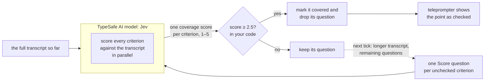

# Intelliprompter

> Tick off a presenter's notes as they speak: TypeSafe scores the live transcript against each note not yet covered, and a note stays ticked once its score passes the threshold.

*Intelliprompter checks off each talking point as you cover it, with one `Score` question
per point.*

A teleprompter tells you what to say. But if you are presenting from bullet-point notes,
you may care more whether **what you've already said** covers each planned point.

**Intelliprompter** listens as you give a presentation and, in near real time, compares
what you have said with what you planned to say.

[Intelliprompter demo](https://player.vimeo.com/video/1230923851)

As you talk, the app builds a cumulative transcript. Every half second, it checks whether
that transcript has changed. It sends the full transcript to Jev with one question for
each unchecked criterion: "How completely has the speaker covered this criterion?"

The animation below shows how new chunks of the transcript get processed. Each addition
can check off zero or more criteria. Once something is marked as complete, it can't later
be unmarked.


## How Intelliprompter works

The demo video at the top of the page shows a working system, integrating your
microphone with ElevenLabs and a local app that uses TypeSafe to score the transcript and
keep track of which items are completed.

This cookbook skips the integration code to focus on the TypeSafe parts. It hard-codes six
chunks from the transcript and feeds them incrementally to Jev:

* The [state](https://docs.typesafe.ai/concepts/state.md) is the full transcript so far.
* Each unchecked criterion becomes a [`Score` question](https://docs.typesafe.ai/primitives/score) with five
  coverage levels.
* One `system_one` request sends the state and all the questions together.
* Jev returns one score for each criterion. The SDK numbers the five levels 0–4, so
  the cookbook adds one to match the live app's 1–5 display.
* A score of 2.5 out of 5 is the demo's local coverage threshold, not a TypeSafe
  confidence value. The app marks that criterion covered and omits it from later
  requests.



## Setup

To run this example locally, [create a TypeSafe API key](https://console.typesafe.ai/keys),
then run these commands in your terminal and replace `<ADD_YOUR_KEY>` with your key.

```bash
pip install ipython 'cooksafe>=0.2.0,<0.3.0'
export TYPESAFE_API_KEY="<ADD_YOUR_KEY>"
```

Every API call is cached in
[`json_cache.json`](https://github.com/typesafe-ai/typesafe-public-examples/blob/main/cookbooks/intelliprompter/json_cache.json).
Download it into the folder you run this code from to replay the published numbers
instead of calling the API, or leave it out to run everything live.

Numbers below came from `jev-1.13.0` on 2026-09-29.

```python
import os
from pathlib import Path

from cooksafe import JsonCache, make_playground_link
from IPython.display import Markdown, display
from typesafe_sdk import Score, TypeSafeClient

TYPESAFE_MODEL = "jev-1.13.0"
COVERED_AT = 2.5  # the live app's default threshold on its 1–5 scale

client = TypeSafeClient(
    api_key=os.environ.get("TYPESAFE_API_KEY", "cache-only"),  # cached re-renders need no key
    model=TYPESAFE_MODEL,
    timeout=120.0,
)
json_cache = JsonCache(Path("json_cache.json"))
```

Each criterion has short text (`display`) for the screen and a longer description
(`description`) for Jev. The description tells Jev what to look for in the transcript.

```python expandable
CHECKLIST = [
    {
        "title": "Introduce Intelliprompter",
        "criteria": [
            {
                "display": "Say its name",
                "description": "The speaker said the name Intelliprompter.",
            },
            {
                "display": "Explain what it does",
                "description": (
                    "The speaker described Intelliprompter as a teleprompter that listens "
                    "and checks off talking points as they are covered."
                ),
            },
        ],
    },
    {
        "title": "Explain the scoring loop",
        "criteria": [
            {
                "display": "Send the rolling transcript",
                "description": (
                    "The speaker explained that the accumulated transcript is sent to "
                    "TypeSafe for scoring."
                ),
            },
            {
                "display": "Score each criterion",
                "description": (
                    "The speaker explained that each criterion gets a score from 1 to 5, "
                    "and a talking point completes when all its criteria are covered."
                ),
            },
        ],
    },
    {
        "title": "Name useful use cases",
        "criteria": [
            {
                "display": "Give at least two uses",
                "description": (
                    "The speaker named at least two suitable uses, such as conference talks, "
                    "lectures, or product demos."
                ),
            }
        ],
    },
]

for point in CHECKLIST:
    print(point["title"])
    for criterion in point["criteria"]:
        print(f"  [ ] {criterion['display']}")
```

```
Introduce Intelliprompter
  [ ] Say its name
  [ ] Explain what it does
Explain the scoring loop
  [ ] Send the rolling transcript
  [ ] Score each criterion
Name useful use cases
  [ ] Give at least two uses
```

## Tell Jev what each score means

A `Score` question needs a clear scale. We give it five levels, from "Not mentioned at
all" to "Covered well and with useful detail". Jev scores each criterion against the
transcript.

The SDK returns a score from 0 to 4: each level number multiplied by its probability,
added up, so it can land between two levels. The live demo shows the same result from 1
to 5, so `score_tick` adds one. The app marks a criterion as checked when this score
reaches 2.5.

One request can score several criteria. Every criterion sees the same full transcript.

```python
SCORE_LEVELS = [
    "Not mentioned at all",
    "Briefly or indirectly mentioned",
    "Mentioned directly",
    "Mostly covered",
    "Covered well and with useful detail",
]

def score_question(description: str) -> Score:
    return Score(
        instructions=(
            "How completely has the speaker covered this criterion in `transcript`: "
            f'"{description}"'
        ),
        criteria=SCORE_LEVELS,
    )

@json_cache
def score_tick(transcript: str, pending: tuple[tuple[str, str], ...]) -> dict:
    response = client.system_one(
        state={"transcript": transcript},
        questions={key: score_question(description) for key, description in pending},
    )
    return {
        "answers": {
            key: {"score": answer.score + 1} for key, answer in response.scores.items()
        }
    }
```

## Keep checked criteria checked

Jev returns scores; it does not keep checklist state. The app stores covered criterion
keys in a set. When a score reaches the configured coverage threshold, the app adds that
key. This demo uses 2.5 out of 5. Later requests omit covered keys, so a checked
criterion is not scored again.

The live app starts a new tick when the transcript changes and no request is in
progress. Our cookbook replay uses a normal loop because its six transcript chunks define
those ticks.

```python expandable
SPEECH_CHUNKS = [
    "Hello. This is Intelliprompter.",
    (
        "It is a smart teleprompter. It listens while I present and marks points "
        "after I cover them."
    ),
    (
        "As I keep speaking, the complete transcript so far goes to TypeSafe for "
        "review, not just my last line."
    ),
    (
        "Each remaining requirement gets a score out of five, and a point is done "
        "when all its requirements are met."
    ),
    "You could use it on stage at an industry event.",
    "Teachers could use it in class, and so could anyone showing customers new software.",
]

def pending_criteria(covered: set[str]) -> tuple[tuple[str, str], ...]:
    return tuple(
        (f"c_{point_index}_{criterion_index}", criterion["description"])
        for point_index, point in enumerate(CHECKLIST)
        for criterion_index, criterion in enumerate(point["criteria"])
        if f"c_{point_index}_{criterion_index}" not in covered
    )

def run_loop(chunks: list[str]) -> tuple[set[str], dict[str, dict], list[dict]]:
    transcript = ""
    covered: set[str] = set()
    latest: dict[str, dict] = {}
    ticks: list[dict] = []  # what each request sent, for the playground link below

    for tick, chunk in enumerate(chunks, 1):
        transcript = f"{transcript} {chunk}".strip()
        pending = pending_criteria(covered)
        if not pending:
            break
        ticks.append({"transcript": transcript, "pending": pending})

        result = score_tick(transcript, pending)

        new_checks = 0
        for key, answer in result["answers"].items():
            latest[key] = answer
            if answer["score"] >= COVERED_AT:
                covered.add(key)
                new_checks += 1

        scores = ", ".join(
            f"{key}={answer['score']:.2f}" for key, answer in result["answers"].items()
        )
        print(
            f"tick {tick}: {len(transcript.split()):>2} words | "
            f"{scores} | +{new_checks} checks"
        )

    return covered, latest, ticks

covered, latest, ticks = run_loop(SPEECH_CHUNKS)
```

```
tick 1:  4 words | c_0_0=3.02, c_0_1=1.11, c_1_0=1.00, c_1_1=1.00, c_2_0=1.00 | +1 checks
tick 2: 21 words | c_0_1=3.74, c_1_0=1.00, c_1_1=1.10, c_2_0=1.09 | +1 checks
tick 3: 40 words | c_1_0=3.76, c_1_1=1.15, c_2_0=1.06 | +1 checks
tick 4: 60 words | c_1_1=3.67, c_2_0=1.10 | +1 checks
tick 5: 70 words | c_2_0=2.06 | +0 checks
tick 6: 84 words | c_2_0=3.93 | +1 checks
```

Early ticks can show progress without changing the checklist. Once a score reaches 2.5,
the criterion stays covered and leaves future requests. Every other unchecked criterion
remains in the next request, regardless of its position in the checklist.

## Read the final checklist

Jev returns the scores. The application turns them into a stable checklist. Jev does not
control the order, the 2.5 rule, or the one-way state change.

```python
for point_index, point in enumerate(CHECKLIST):
    print(point["title"])
    for criterion_index, criterion in enumerate(point["criteria"]):
        key = f"c_{point_index}_{criterion_index}"
        state = "✓" if key in covered else " "
        answer = latest.get(key, {"score": 0.0})
        print(f"  [{state}] {criterion['display']:<30} score {answer['score']:.2f}")
```

```
Introduce Intelliprompter
  [✓] Say its name                   score 3.02
  [✓] Explain what it does           score 3.74
Explain the scoring loop
  [✓] Send the rolling transcript    score 3.76
  [✓] Score each criterion           score 3.67
Name useful use cases
  [✓] Give at least two uses         score 3.93
```

To use this pattern with a real stream, replace `SPEECH_CHUNKS` with your transcription
provider's accumulated text. Keep the score descriptions specific, and keep the threshold
in code.

## Try it in the playground

The link below holds the third tick: the transcript after three chunks as the state, and
a `Score` question for every criterion still unchecked at that point. Edit the transcript
there and the scores change with it.

```python
third = ticks[2]
playground_link = make_playground_link(
    {"transcript": third["transcript"]},
    {key: score_question(description) for key, description in third["pending"]},
    models=[TYPESAFE_MODEL],
)
display(
    Markdown(
        f"🔗 [Open one scoring tick in the TypeSafe playground]({playground_link})"
    )
)
```

[Open one scoring tick in the TypeSafe playground →](https://console.typesafe.ai/playground#share/N4IgJg9gxgrgtgUwHYBcAqCAeKQC4AEIwAOiCgE4CGSAzlOQJYAOKpBpAEggDbcQB0+NAAsGNfGPwBJVD27NyEOCwTlBUlBPGV8NOJXKaUPBE0XLja6Zvk1jtfAHdR3BNPxmENZJuph8+uQA1uJMEAyo2gBmlu5QEABuqvgowghwggCC4lL4QQimukwIlEERAOYANClp+PHKrsYpVLT0zJo0EPhRBvjlEF4pXWgAnsUAypRRblEQ5PjkCAkMCI7VSBCaAFYwdgEj+NyUe-JICPykAL4g1SBmSiw0GNh4hCQgUAD6AIyfAAxsfDvFBjBCA0h0OZgm74UgROzkGBQFAMCC0cEgDgQRx1B6NHgHYTHGpuGjFUrJeJJRb+VKSNqWVFICTMgAGFGodEYLFZ7GIpBEpPJ+XmWCYRwiCFpRKMtUoUFgcBgR2MtJaXPaWl0PiGQlBk2m3TmunijCQ5Qu-JApGqpAZqgYlEBAG1SAA5TYBHxMqX4Si+Xg22EgABCjAQUW4B2NETADEWyKjXtQPrAQdIAFlvWjfXGEygo+mQBmIHYk1TVFKiwBhRKV-yOOR+pANhipfC7CPK-BgBAoSgMbikAC6l1tHx+P0BwNBGMhiyL8IoSJRaJoGKxOPq4r7BPwRPEqSFJRFuOpvrp4ntjDRLPw7PVbR5fIFtTJJ+SYolZ2l-vwJSgYQ6kYRlb3KPttBNKFunMfBvl1ABWao-D9FJKG4MpzQ8cJUFxBpd3EZxkD9XgJBQK8QIdHQDDcCsaUtUgi2vR0XXdT1EBTHN-D-dChxhUgwxWSNo3mWN4wQRMDg41cfyLLNOJ-HtxMkuTSwLA46KrfiQFrc8GybFDHDbIDOyibte37QcRzHYMvgAJn+adSBBYo51NaFxyXRFkSZddXk4bE8J3YwkwPEkig-eZNOlelKJvZkInvDlWm5FBeVhK1BQiil5iQShEG4mwSj2FBHC6GgYDbSgACNXA7bwaGqCrAL9K80WmRYkCgNx+wwxrDgklAYEWfrjXuMAVx7dJSwY61tOYp1XldEAPU0aTUz9AM+PHQSIyTGMW2U9TkxkrTx3k07-DzQbC20ksyw0usaRrJ7fUbUjDOM+qu24KbLL40drluSgmAYAA1VQaCZV4QASb4YRAbxXGRKUS17bgaCWkAtiWABab5+G+ABmfg-hAUcgA)

This documentation is built and hosted on [Mintlify](https://mintlify.com), a developer documentation platform.
