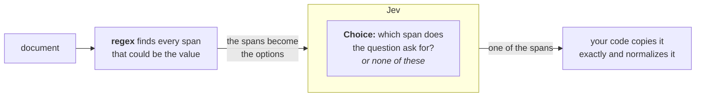

# Pre-parsed value extraction

> Finds candidate emails, phone numbers, and amounts with a regex, has Jev pick the one you ask for, and normalizes that exact span in code.

*A regex finds the candidate values, Jev picks the one the question asks for,
and we copy it verbatim.*

We pull three values out of text: the address a sender wants their receipt sent to, a
phone number as `+14155550177`, and an invoice total as `1315.50 USD` flagged as a charge.
Each starts as a span copied unchanged from the document. Jev only chooses among
spans a regex already found, so it cannot invent a value or transpose a digit. You can
point the same `find` and `pick` pair at your own documents. There are three steps:

1. A regex finds the candidate values in the text. Tune it to catch every real value,
   even if it also catches some wrong ones.
2. Jev picks which candidate the question is asking for, and reads off any
   attribute we need downstream (currency, country, whether an amount is a credit or a
   charge).
3. We copy the picked value and normalize it.

[Date extraction](https://docs.typesafe.ai/cookbooks/date_extraction_cookbook.md) splits the work the same way:
Jev reads a date's parts off the text, and we do the calendar math in code.



## Setup

```bash
pip install ipython phonenumbers 'cooksafe>=0.3.0,<0.4.0'
```

then set `TYPESAFE_API_KEY`.

```python
import os
import re
import urllib.request
from decimal import Decimal
from pathlib import Path

import phonenumbers
from cooksafe import JsonCache, make_playground_link
from IPython.display import Markdown, display
from typesafe_sdk import Choice, Noul, TypeSafeClient

TYPESAFE_MODEL = "jev-1.14.0"  # the page's model; "jev-latest" runs the newest, live
NONE = "none"  # the escape hatch on every selection: "none of the candidates fits"

# base_url defaults to https://api.typesafe.ai/ ; the env override points at another deployment.
ts = TypeSafeClient(
    api_key=os.environ.get(
        "TYPESAFE_API_KEY", "cache-only"
    ),  # cached re-renders need no key
    base_url=os.environ.get("TYPESAFE_BASE_URL"),
    timeout=30.0,
)
```

```python
EXAMPLES_URL = (
    "https://raw.githubusercontent.com/typesafe-ai/typesafe-public-examples/main/"
    "cookbooks/pre_parsed_value_extraction_cookbook"
)

def download(name: str) -> Path:
    """Fetch one of this cookbook's files from typesafe-public-examples unless it is on disk."""
    path = Path(name)
    if not path.exists():
        urllib.request.urlretrieve(f"{EXAMPLES_URL}/{name}", path)
    return path

CACHE = Path("pre_parsed_value_extraction_cookbook_cache.json")
# True fills CACHE with the published answers, so the run makes no requests. To run
# live, set it to False and delete CACHE; a CACHE already on disk is never overwritten.
DOWNLOAD_CACHE = True
if DOWNLOAD_CACHE:
    download(CACHE.name)
json_cache = JsonCache(CACHE)
```

## Helpers

We find candidates with a regex that catches every real value, and drop duplicate
matches (`find`). We pick one with a `Choice` question whose options are those spans
(`pick`), so the answer is one of them copied exactly, or `none` when no candidate fits.
The currency and the country come from a `Choice` question over a fixed set of labels
(`classify`), and whether an amount is a credit from a `Noul` question (`is_true`).

The code downloads the published answers into
`pre_parsed_value_extraction_cookbook_cache.json`, so the run makes no requests; to run
live, set `DOWNLOAD_CACHE = False` and delete that file.

```python expandable
EMAIL_RE = re.compile(r"[A-Za-z0-9._%+-]+@[A-Za-z0-9.-]+\.[A-Za-z]{2,}")
PHONE_RE = re.compile(r"\(?\+?\d[\d\s()\-.]{6,}\d")
MONEY_RE = re.compile(r"[$€£¥]\s?\d[\d,]*(?:\.\d{2})?")

def find(pattern: re.Pattern, text: str) -> list[str]:
    """Code-side candidate finder: recall-tuned regex, deduped, in document order."""
    seen: set[str] = set()
    out: list[str] = []
    for match in pattern.findall(text):
        span = match.strip()
        if span and span not in seen:
            seen.add(span)
            out.append(span)
    return out

@json_cache
def pick(document: str, candidates: list[str], question: str, model: str) -> dict:
    """Jev selects which found span plays the role. Returns {choice, confidence}.

    The options ARE the candidate spans, so ``choice`` is a verbatim copy of one of them (or the
    ``none`` hatch). The model chooses; code owns the string."""
    criteria = {c: None for c in candidates} | {
        NONE: "None of these is the requested value."
    }
    answer = ts.system_one(
        state=document,
        questions={"pick": Choice(instructions=question, criteria=criteria)},
        model=model,
    ).answers["pick"]
    return {"choice": answer.choice, "confidence": answer.confidence}

@json_cache
def classify(document: str, question: str, options: list[str], model: str) -> dict:
    """A small Choice over a fixed label set (currency, country, ...). Returns {choice, confidence}."""
    answer = ts.system_one(
        state=document,
        questions={
            "q": Choice(instructions=question, criteria={o: None for o in options})
        },
        model=model,
    ).answers["q"]
    return {"choice": answer.choice, "confidence": answer.confidence}

@json_cache
def is_true(document: str, question: str, model: str) -> float:
    """A yes/no Noul. Returns P(yes)."""
    return (
        ts.system_one(
            state=document,
            questions={"q": Noul(instructions=question)},
            model=model,
        )
        .answers["q"]
        .noul
    )
```

## Email: pick the right address by role

The headers hold four addresses. The body asks for the receipt to go to a personal
address instead of the `To:` billing alias, so the answer depends on reading the body.
We ask two questions: which address gets the receipt, and which one sent the message.

```python
EMAIL_DOC = """From: Jane Doe <jane.doe@example.com>
To: billing@example.com
Cc: orders@example.com
Reply-To: jane.personal@example.net

Hi team - please don't use the billing alias for this one. Send my receipt to my
personal address instead. Thanks, Jane."""

emails = find(EMAIL_RE, EMAIL_DOC)
receipt = pick(
    EMAIL_DOC,
    emails,
    "Which email address does the sender want their receipt sent to?",
    model=TYPESAFE_MODEL,
)
sender = pick(
    EMAIL_DOC,
    emails,
    "Which email address did this message come from (the From line)?",
    model=TYPESAFE_MODEL,
)

print("candidates :", emails)
# code copies the picked value verbatim and normalizes (lowercase); it never re-types it
print(
    f"receipt -> : {receipt['choice'].lower():<28} (conf {receipt['confidence']:.2f})"
)
print(f"sender  -> : {sender['choice'].lower():<28} (conf {sender['confidence']:.2f})")
```

```
candidates : ['jane.doe@example.com', 'billing@example.com', 'orders@example.com', 'jane.personal@example.net']
receipt -> : jane.personal@example.net    (conf 0.97)
sender  -> : jane.doe@example.com         (conf 1.00)
```

The receipt goes to the personal address on the `Reply-To:` line, as the body asks. The
sender is the address on the `From` line. Both are copies of regex matches, which we
lowercase.

## Phone: pick the mobile, normalize to E.164

The text has three numbers, and none of them carries a country code. Jev picks the
mobile and reads the country from the text; `phonenumbers` combines those two answers
into E.164, the international format that starts with a `+` and the country code.

```python
PHONE_DOC = """Reach our San Francisco office at these numbers: main desk (415) 555-0199,
billing fax (415) 555-0142, and my direct cell (415) 555-0177. Call the cell if it's urgent."""

phones = find(PHONE_RE, PHONE_DOC)
mobile = pick(
    PHONE_DOC, phones, "Which of these is the direct mobile / cell number?", model=TYPESAFE_MODEL
)
region = classify(
    PHONE_DOC,
    "In what country is this office located?",
    ["US", "GB", "DE", "FR", "CA", "AU"],
    model=TYPESAFE_MODEL,
)

# code copies the picked value and normalizes it with the model-supplied country
parsed = phonenumbers.parse(mobile["choice"], region["choice"])
e164 = phonenumbers.format_number(parsed, phonenumbers.PhoneNumberFormat.E164)

print("candidates :", phones)
print(f"mobile  -> : {mobile['choice']}  (conf {mobile['confidence']:.2f})")
print(f"country -> : {region['choice']}  (conf {region['confidence']:.2f})")
print(f"E.164   -> : {e164}")
```

```
candidates : ['(415) 555-0199', '(415) 555-0142', '(415) 555-0177']
mobile  -> : (415) 555-0177  (conf 1.00)
country -> : US  (conf 1.00)
E.164   -> : +14155550177
```

Nothing in the digits says which number is the mobile or what country it is in; the
words around them do. Jev reads those words, and `phonenumbers` formats the picked
number as `+14155550177`.

## Money: pick the amount, classify the currency, flag credit vs charge

The invoice has four amounts on it. Jev picks the total due and the credit, reads
the currency, and flags each picked amount as a charge or a credit. We copy each picked
string and parse it into a `Decimal`.

```python expandable
MONEY_DOC = """Invoice INV-2087.
Subtotal: $1,200.00
Sales tax: $115.50
Total due: $1,315.50
A $50.00 courtesy credit from last month has already been applied."""

amounts = find(MONEY_RE, MONEY_DOC)
currency = classify(
    MONEY_DOC,
    "What currency are these amounts in?",
    ["USD", "EUR", "GBP", "JPY", "CAD"],
    model=TYPESAFE_MODEL,
)
total = pick(
    MONEY_DOC, amounts, "Which amount is the total the customer must pay?", model=TYPESAFE_MODEL
)
credit = pick(
    MONEY_DOC,
    amounts,
    "Which amount is the courtesy credit that was applied?",
    model=TYPESAFE_MODEL,
)

def to_decimal(value: str) -> Decimal:
    """Copy the picked value and parse the number in code (US grouping/decimal here)."""
    return Decimal(re.sub(r"[^\d.]", "", value))

for label, chosen in [("total due", total), ("credit", credit)]:
    is_credit = is_true(
        MONEY_DOC,
        f"Is the amount {chosen['choice']} a credit or refund to the customer, not a charge?",
        model=TYPESAFE_MODEL,
    )
    kind = "credit" if is_credit > 0.5 else "charge"
    print(
        f"{label:<10}: {chosen['choice']:<10} -> {to_decimal(chosen['choice'])} {currency['choice']} "
        f"({kind}, P(credit)={is_credit:.2f})"
    )
print("\ncandidates :", amounts)
```

```
total due : $1,315.50  -> 1315.50 USD (charge, P(credit)=0.03)
credit    : $50.00     -> 50.00 USD (credit, P(credit)=0.98)

candidates : ['$1,200.00', '$115.50', '$1,315.50', '$50.00']
```

The total due is \$1,315.50 and the credit is \$50.00, both in USD. The credit-or-charge
`Noul` question gives 0.03 for the total and 0.98 for the credit, so we know the sign of
each `Decimal` we parse.

> We parse amounts on the assumption that the comma groups thousands and the dot is the
> decimal point. That holds for `$1,315.50`; in `€1.315,50` it is the other way round. Ask a
> `Noul` question such as "Does this document use a comma as the decimal point?" and branch
> on the answer.

## Open it in the TypeSafe playground

To try the receipt question yourself, open the email thread in the playground. The four
addresses the regex found are the question's options.

```python
receipt_criteria = {e: None for e in emails} | {
    NONE: "None of these is the requested value."
}
playground_link = make_playground_link(
    EMAIL_DOC,
    {
        "receipt": Choice(
            instructions="Which email address does the sender want their receipt sent to?",
            criteria=receipt_criteria,
        )
    },
)
display(
    Markdown(
        f"🔗 [Open this thread + selection in the TypeSafe playground]({playground_link})"
    )
)
```

[Open this thread + selection in the TypeSafe playground →](https://console.typesafe.ai/playground#share/N4IgJg9gxgrgtgUwHYBcAqCAeKQC4AEIAYgE4RwEBSAhkgvgCIT0A8AVrQgHSQIACWanAAOAG25RyAPgA6SNBAIAjAJajRKpAHMBmIWInk5AYSgEIJMAhIBnXfvFdJcOQCUEYgJ4BaBQQ50XMLWNhBI1KL2Io50KHJyABIq+CgIQvje+AbUNvSQSADkKPgwuSkAFvSq6ppa+BEqOfgAZhYVKjb4Ydz4AMrIYPhwnvgkCFAIKsLFKBBDnnLBtmER9WBgYzadmjap1GBc+GjltADWNgA0+DSBIFcgwmQiKDYY2HiEwDIgYxNTcR8viAUJ5gt8CN8oOUICoJt8rt8digSDAoCgVGEbOD8N8AOrlWHlfAIODUNRrDYILb4XidFCVfC5JBWEj4ADutBmlRUrN+k2mjOQMwgAH54TiQFASCpUtLqNigQFuLwogYnEYPkgYOoESBqhptKrHM5sVqdRKLCy7IJooYXJrtaJdUqgiEVpEbWrYqbHbqkN1sd8AHLdLrNCpU+gdCOjBAARxgVNSgwAbhFE1xvgBfHN3QjUYQqABqIQxSA+IBTAEYQFmgA)

## Two limits

* A `Choice` question allows at most 255 options. With more candidates than that, narrow
  in two stages: pick the section first, then the span inside it.
  [Line-by-line search](https://docs.typesafe.ai/cookbooks/semantic_find.md) shows the first stage: tag each line
  with an ID and let a `Choice` point to the lines that match.
* Finding the candidates is the part that takes work. Emails, phone numbers and amounts
  have regexes that cover them; a name does not, so its candidates have to come from a
  roster you already have, or from a named-entity recognizer or an LLM that proposes
  them. Jev then picks the one the question asks for.

This documentation is built and hosted on [Mintlify](https://mintlify.com), a developer documentation platform.
