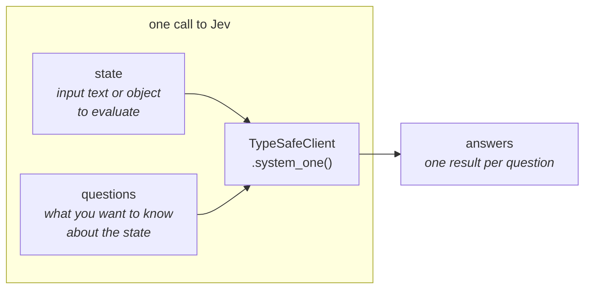

# Quick start

> Get up and running with Jev in 5 minutes.

This guide covers four ways of using Jev, TypeSafe's [System One model](https://docs.typesafe.ai/concepts/system-one.md), namely: [use our SDK](#code-it-your-first-request), [call our API](#call-it-the-api), [use our agent skill](#vibe-it-the-agent-skill), or [try our browser-based Playground](#try-it-the-playground).

Get an API key from the [TypeSafe console](https://console.typesafe.ai/keys).

## The minimum you should know to use Jev effectively

Each call to Jev takes a [state](https://docs.typesafe.ai/concepts/state.md) (as a simple string or structured object) and a set of [questions](https://docs.typesafe.ai/primitives), and returns one answer per question:



Jev answers three types of question, called primitives:

| Question type | Goal | Returns |
| - | - | - |
| [Choice](https://docs.typesafe.ai/primitives/choice.md) | Choose an option from a list | `choice`, `probabilities`, `confidence` |
| [Score](https://docs.typesafe.ai/primitives/score.md) | Score the state on a rubric | `score`, `probabilities`, `confidence` |
| [Noul](https://docs.typesafe.ai/primitives/noul.md) | Is this statement true? | `noul` (0–1) |

## Vibe it: the Agent Skill

The fastest way to add Jev to your project is to have your coding agent write the integration with the TypeSafe skill installed.

1. **[Install the TypeSafe skill](https://docs.typesafe.ai/agent-skill.md#installation)** using the Claude Code plugin or `npx skills add typesafe-ai/skills --skill typesafe-ai`. You can also [read SKILL.md on GitHub](https://github.com/typesafe-ai/skills/blob/main/skills/typesafe-ai/SKILL.md).

**Claude Code**

Run these two commands in your terminal:

```bash
claude plugin marketplace add typesafe-ai/skills
claude plugin install typesafe@typesafe-ai
```

**Other agents**

```bash
npx skills add typesafe-ai/skills --skill typesafe-ai
```

Choose your agent when prompted. Installation is project-local by default; add `-g` to install globally.

**Copy to your agent**

Paste this prompt into your coding agent:

```text wrap
Install the TypeSafe skill. If you're in Claude Code, run `claude plugin marketplace add typesafe-ai/skills`, then `claude plugin install typesafe@typesafe-ai`. If you're in another agent, run `npx skills add typesafe-ai/skills --skill typesafe-ai` and select your agent. Use one installation method. You can read the skill directly at https://github.com/typesafe-ai/skills/blob/main/skills/typesafe-ai/SKILL.md (raw: https://raw.githubusercontent.com/typesafe-ai/skills/main/skills/typesafe-ai/SKILL.md). Then use the TypeSafe skill when working on this project.
```

2. **Tell your coding agent** to use the TypeSafe skill as you build.

```plaintext title="Coding agent prompt"
Let's build a simple CLI that uses Jev to evaluate a set of supplied texts on multiple dimensions. Use the TypeSafe skill to understand how to use the TypeSafe API and how to structure the system. Ask me questions about what kinds of texts I want to evaluate and on what dimensions.
```

> [!NOTE]
>
> We suggest that you generate and store your TypeSafe API key in an environment variable (e.g. `TYPESAFE_API_KEY`).

The [Agent Skill](https://docs.typesafe.ai/agent-skill.md) page has more example prompts and fixes for common issues, such as an agent that isn't using the skill.

## Code it: your first request

See how to call Jev from your favourite programming language. The Python, JavaScript, and TypeScript examples use our SDKs; the Bash example calls the API directly.

Create a working directory and set your API key. These setup commands use Bash on macOS, Linux, or Windows with WSL:

```bash wrap
mkdir typesafe-quickstart
cd typesafe-quickstart
export TYPESAFE_API_KEY="your-api-key"
```

The example sends a customer support ticket and asks Jev three questions in one request: which team should handle it, how frustrated the customer sounds, and whether the issue is urgent.

**Python**

Requires Python 3.10 or later. Choose a package manager to install the SDK:

**pip**

With [pip installed](https://pip.pypa.io/en/stable/installation/), create a virtual environment and add the SDK:

```bash wrap
python3 -m venv .venv
.venv/bin/pip install typesafe-sdk
```

**uv**

With [uv installed](https://docs.astral.sh/uv/getting-started/installation/), initialize a project and add the SDK:

```bash wrap
uv init --bare
uv add typesafe-sdk
```

Save as `route_ticket.py`:

```python wrap
from typesafe_sdk import Choice, Noul, Score, TypeSafeClient

ticket = "Our API integration started returning 500 errors on every request about 20 minutes ago, and we can't process any customer orders until this is fixed."

with TypeSafeClient(model="jev-latest") as client:  # Reads TYPESAFE_API_KEY.
    response = client.system_one(
        state=ticket,
        questions={
            "department": Choice(
                instructions="Which team should handle this",
                criteria={
                    "billing": "Payment or subscription issues",
                    "technical": "Bugs or integration problems",
                    "sales": "Pricing or account questions",
                },
            ),
            "frustration": Score(
                instructions="How frustrated the customer appears",
                criteria=[
                    "Calm, just stating facts",
                    "Frustrated but civil",
                    "Very angry, strong language",
                ],
            ),
            "is_urgent": Noul(
                instructions="The message conveys urgency or time-sensitivity",
            ),
        },
    )

print(response.choices["department"].choice)
print(response.scores["frustration"].score)
print(response.nouls["is_urgent"].noul)
```

Run it with either installation method:

```bash wrap
.venv/bin/python route_ticket.py
```

**JavaScript**

Requires Node.js 20 or later. Install the SDK and mark the project as an ES module:

```bash wrap
npm install @typesafe-ai/sdk
npm pkg set type=module
```

Save as `route_ticket.js`:

```javascript wrap
import { choice, noul, score, TypeSafeClient } from "@typesafe-ai/sdk";

const ticket = "Our API integration started returning 500 errors on every request about 20 minutes ago, and we can't process any customer orders until this is fixed.";

const client = new TypeSafeClient({ defaultModel: "jev-latest" }); // Reads TYPESAFE_API_KEY.
const response = await client.systemOne({
  state: ticket,
  questions: {
    department: choice("Which team should handle this", {
      billing: "Payment or subscription issues",
      technical: "Bugs or integration problems",
      sales: "Pricing or account questions",
    }),
    frustration: score("How frustrated the customer appears", [
      "Calm, just stating facts",
      "Frustrated but civil",
      "Very angry, strong language",
    ]),
    is_urgent: noul("The message conveys urgency or time-sensitivity"),
  },
});

console.log(response.answers.department.choice);
console.log(response.answers.frustration.score);
console.log(response.answers.is_urgent.noul);
```

Run it:

```bash wrap
node route_ticket.js
```

**TypeScript**

Requires Node.js 22.18 or later to run TypeScript directly. Install the SDK and mark the project as an ES module:

```bash wrap
npm install @typesafe-ai/sdk
npm pkg set type=module
```

Save as `route_ticket.ts`:

```typescript wrap
import { choice, noul, score, TypeSafeClient } from "@typesafe-ai/sdk";

const ticket = "Our API integration started returning 500 errors on every request about 20 minutes ago, and we can't process any customer orders until this is fixed.";

const client = new TypeSafeClient({ defaultModel: "jev-latest" }); // Reads TYPESAFE_API_KEY.
const response = await client.systemOne({
  state: ticket,
  questions: {
    department: choice("Which team should handle this", {
      billing: "Payment or subscription issues",
      technical: "Bugs or integration problems",
      sales: "Pricing or account questions",
    }),
    frustration: score("How frustrated the customer appears", [
      "Calm, just stating facts",
      "Frustrated but civil",
      "Very angry, strong language",
    ]),
    is_urgent: noul("The message conveys urgency or time-sensitivity"),
  },
});

console.log(response.answers.department.choice);
console.log(response.answers.frustration.score);
console.log(response.answers.is_urgent.noul);
```

Run it:

```bash wrap
node route_ticket.ts
```

The SDK infers answer types from your questions, so `response.answers.department.choice` has the type `"billing" | "technical" | "sales"`.

**Bash**

Requires curl 7.76 or later. Save as `route_ticket.sh`:

```bash wrap
#!/usr/bin/env bash
set -euo pipefail
: "${TYPESAFE_API_KEY:?Set TYPESAFE_API_KEY first.}"

curl --fail-with-body --silent --show-error \
  https://api.typesafe.ai/v1/systemone \
  -H "Authorization: Bearer $TYPESAFE_API_KEY" \
  -H "Content-Type: application/json" \
  --data-binary @- <<'JSON'
{
  "state": "Our API integration started returning 500 errors on every request about 20 minutes ago, and we can't process any customer orders until this is fixed.",
  "model": "jev-latest",
  "questions": {
    "department": {
      "type": "choice",
      "instructions": "Which team should handle this",
      "criteria": {
        "billing": "Payment or subscription issues",
        "technical": "Bugs or integration problems",
        "sales": "Pricing or account questions"
      }
    },
    "frustration": {
      "type": "score",
      "instructions": "How frustrated the customer appears",
      "criteria": [
        "Calm, just stating facts",
        "Frustrated but civil",
        "Very angry, strong language"
      ]
    },
    "is_urgent": {
      "type": "noul",
      "instructions": "The message conveys urgency or time-sensitivity"
    }
  }
}
JSON
```

Run it:

```bash wrap
bash route_ticket.sh
```

Jev evaluates each question against the same state and returns answers under the IDs you supplied. `choice` is the team label, `score` is the position on the three-level frustration rubric (0–2), and `noul` is the probability of urgency (0–1).

The Python, JavaScript, and TypeScript examples print those three values:

```text Example output
technical
0.67
0.99
```

The Bash example prints the raw JSON response on one line. The Raw Response in the next section shows it formatted, with each answer's confidence and probabilities. These are example results; values can change between Jev releases.

The [client SDKs](https://docs.typesafe.ai/sdk.md) pages cover installing the Python and JavaScript SDKs, typed answers, and their retry policy.

## Call it: the API

All four code examples in the previous section use this endpoint. The Bash tab above shows the complete HTTP request without an SDK.

```http
POST https://api.typesafe.ai/v1/systemone
Authorization: Bearer <API_KEY>
Content-Type: application/json
```

> **Raw Response**
>
> ```json
> {
>   "model": "jev-1.13.0",
>   "answers": {
>     "department": {
>       "type": "choice",
>       "choice": "technical",
>       "confidence": 1.0,
>       "probabilities": {
>         "technical": 1.0,
>         "billing": 0.0,
>         "sales": 0.0
>       }
>     },
>     "frustration": {
>       "type": "score",
>       "score": 0.67,
>       "confidence": 0.5,
>       "legend": {
>         "0": "Calm, just stating facts",
>         "1": "Frustrated but civil",
>         "2": "Very angry, strong language"
>       },
>       "probabilities": {
>         "0": 0.33,
>         "1": 0.67,
>         "2": 0.0
>       }
>     },
>     "is_urgent": {
>       "type": "noul",
>       "noul": 0.99
>     }
>   },
>   "usage": {
>     "input_tokens": 428,
>     "output_tokens": 73
>   }
> }
> ```

The [API Reference](https://docs.typesafe.ai/api) lists every request field, question type, and answer type.

## Try it: the Playground

The Playground runs Jev in the browser: paste a state, add questions, and read the answers without writing code.

1. **Open the [Playground](https://console.typesafe.ai/playground)** and log in.
2. **Paste any text** as the state.

```plaintext title="Sample state"
Our API integration started returning 500 errors on every request about 20 minutes ago, and we can't process any customer orders until this is fixed.
```

3. **Add a question.** Try a Noul question: `"Does this message express urgency?"`

```json
{
  "urgency": {
    "type": "noul",
    "instructions": "Does this message express urgency?"
  }
}
```

4. **Add more questions.** Mix Noul, Choice, and Score questions in one call and see all results at once.

***

## Next Steps

Composing primitives into larger systems takes some practice, even if you're used to LLMs. The [Machine Learning Primer](https://docs.typesafe.ai/introduction/machine-learning-primer.md) explains why Jev returns calibrated probabilities instead of generated text, and how that changes the way you build with it.

We’d also suggest taking a look at [Primitives](https://docs.typesafe.ai/primitives) and the [Use Case Map](https://docs.typesafe.ai/concepts/use-case-map.md).

1. [Errors and retries](https://docs.typesafe.ai/sdk/python/usage/basic.md#error-handling)
2. [Parallel Questions](https://docs.typesafe.ai/cookbooks/parallel_questions.md)

This documentation is built and hosted on [Mintlify](https://mintlify.com), a developer documentation platform.
