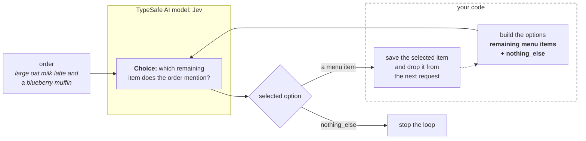
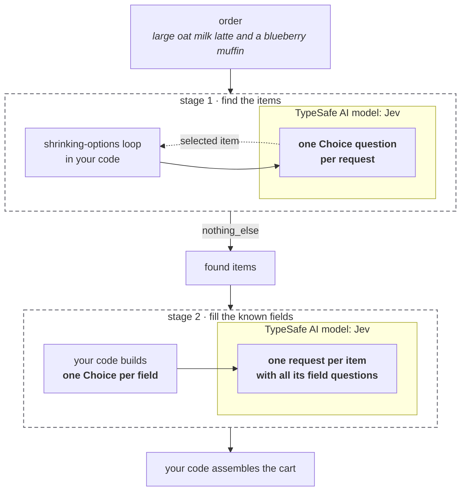

> ## Documentation Index
> Fetch the complete documentation index at: https://docs.typesafe.ai/llms.txt
> Use this file to discover all available pages before exploring further.

# Shopping cart

> Turns a natural-language cafe order into a structured cart: a shrinking-options loop of Choice questions finds every item, then one batched request per item fills its known fields.

A customer can describe an order in one sentence, but an application needs a structured
cart with separate items and fields.

[TypeSafe shopping cart demo](https://player.vimeo.com/video/1230923854)

The TypeSafe part of that demo builds the cart out of several
[`Choice` questions](https://docs.typesafe.ai/primitives/choice), each of which returns one value. Here it runs on
a small cafe menu and one hard-coded order.

## How the cart builder works

The input is one sentence:

```text theme={null}
Can I get a large oat milk latte and a blueberry muffin please
```

The application builds this cart:

```text theme={null}
latte
  size: large
  milk: oat
blueberry_muffin
```

A `Choice` question returns one option, not a whole cart. The application therefore uses
two stages:

1. **Find the items.** Repeatedly ask which remaining menu item the order mentions.
   Remove each selected item from the next request. Stop when Jev selects
   `nothing_else`.
2. **Fill the fields.** For each found item, send one request with a `Choice` question per
   known field. Your code assembles the returned values into the cart.

### Finding an unknown number of items with a loop

The number of ordered items is not known in advance. Each request asks which remaining
menu item appears first in the order. The loop in your code then:

1. saves the selected item;
2. removes it from the next request's options; and
3. sends the full order again with the shorter option list.

A `Choice` question must select an option, so every request also includes
`nothing_else`. That option tells the loop to stop when the order contains no remaining
menu item.



### Filling the known fields

After the item loop, the application knows which schema applies to each item. The latte
schema has `size` and `milk` fields. The application sends both field questions to Jev in
one request. The muffin has no fields, so it needs no field request.



## Setup

```bash theme={null}
pip install ipython 'cooksafe>=0.2.0,<0.3.0'
```

then set `TYPESAFE_API_KEY`. Every API call is cached in
[`json_cache.json`](https://github.com/typesafe-ai/typesafe-public-examples/blob/main/cookbooks/cart_from_primitives/json_cache.json).
Download it into the folder you run this code from to replay the published numbers
instead of calling the API, or leave it out to run everything live.

Numbers below came from `jev-1.14.0` on 2026-10-29.

```python theme={null}
import os
from pathlib import Path

from cooksafe import JsonCache, make_playground_link
from IPython.display import Markdown, display
from typesafe_sdk import Choice, TypeSafeClient

TYPESAFE_MODEL = "jev-1.14.0"
NOTHING_ELSE = "nothing_else"  # the sentinel option that ends the item loop
MAX_ITEM_REQUESTS = 6  # a hard stop, so a bad answer can never loop forever

client = TypeSafeClient(
    api_key=os.environ.get("TYPESAFE_API_KEY", "cache-only"),  # cached re-renders need no key
    model=TYPESAFE_MODEL,
    timeout=30.0,
)
json_cache = JsonCache(Path("json_cache.json"))


def fmt_confidence(confidence: float | None) -> str:
    """A confidence for printing. The API can return None, so never format it blind."""
    return f"{confidence:.2f}" if confidence is not None else "n/a"
```

### Creating the menu

The menu has four items, and only the latte has fields.

Each item's description carries the words a customer would use to order it. Jev matches
the order against these descriptions. `fields` is the item's own schema. Each field is a
list of allowed values, and those values are the options of that field's `Choice` question.

```python theme={null}
MENU = {
    "latte": {
        "description": "Espresso with steamed milk. Also ordered as a flat white or a milky coffee.",
        "fields": {
            "size": ["small", "medium", "large"],
            "milk": ["whole", "oat", "almond"],
        },
    },
    "filter_coffee": {
        "description": "Plain brewed drip coffee, sometimes ordered as a black coffee.",
        "fields": {},
    },
    "blueberry_muffin": {
        "description": "A blueberry muffin.",
        "fields": {},
    },
    "almond_croissant": {
        "description": "An almond croissant, sometimes ordered as a pastry.",
        "fields": {},
    },
}

ORDER = "Can I get a large oat milk latte and a blueberry muffin please"
```

### Finding the items in the order

Before each request, the loop builds a fresh option set from the items not yet found and
adds the `nothing_else` sentinel. The order
is the request's [state](https://docs.typesafe.ai/concepts/state.md), and the question changes from one request to
the next. The loop stops when `nothing_else` is selected.

The loop also caps its requests, so a bad answer can never make it loop forever. It ends
when the sentinel is selected, the menu runs out, or the cap is reached.

```python expandable theme={null}
def item_question(remaining: dict[str, dict], found: list[str]) -> Choice:
    """Build one request's question from the items not found yet."""
    already = ", ".join(found) if found else "nothing yet"
    criteria = {name: item["description"] for name, item in remaining.items()}
    criteria[NOTHING_ELSE] = (
        "The order mentions no menu item other than the ones already accounted for."
    )
    return Choice(
        instructions=(
            f"This is a cafe order. Items already accounted for: {already}. "
            "Which remaining menu item does the order mention? If the order mentions more "
            "than one remaining item, choose the one mentioned first."
        ),
        criteria=criteria,
    )


@json_cache
def ask_item(order: str, question: dict) -> dict:
    """One item request. The question arrives as its API JSON, which also keys the cache."""
    answer = client.system_one(state=order, questions={"item": question}).choices["item"]
    return {"choice": answer.choice, "confidence": answer.confidence}


def find_items(order: str) -> list[dict]:
    remaining = list(MENU)
    found: list[dict] = []
    item_requests = 0
    for _ in range(MAX_ITEM_REQUESTS):
        if not remaining:
            break
        question = item_question(
            {name: MENU[name] for name in remaining},
            [item["name"] for item in found],
        )
        result = ask_item(order, question.model_dump(mode="json", exclude_none=True))
        item_requests += 1
        print(
            f"item request {item_requests}: {len(remaining)} items + sentinel "
            f"-> {result['choice']} (confidence {fmt_confidence(result['confidence'])})"
        )
        if result["choice"] == NOTHING_ELSE:
            break
        remaining.remove(result["choice"])
        found.append({"name": result["choice"], "confidence": result["confidence"]})
    return found


items = find_items(ORDER)
print(f"\nfound {len(items)} items: {[item['name'] for item in items]}")
```

```
item request 1: 4 items + sentinel -> latte (confidence 0.99)
item request 2: 3 items + sentinel -> blueberry_muffin (confidence 1.00)
item request 3: 2 items + sentinel -> nothing_else (confidence 1.00)

found 2 items: ['latte', 'blueberry_muffin']
```

On this order, the first two item requests each found an item. The third selected the
sentinel and ended the loop.

Because each found item leaves the option list, the loop finds each menu item at most
once. The cart also has no quantity field, so an order for "two flat whites" still
produces one `latte`. To handle quantities, add a `quantity` field to each item's schema,
with values such as `one`, `two` and `three`.

### Filling in a found item's fields

For each found item, we build one `Choice` question per known field and send them together
in one `system_one` call against the same order. This is the
[fan-out pattern](https://docs.typesafe.ai/patterns/fan-out.md).

Each field question also includes `unspecified`, so a field the customer did not mention
gets that option instead of a forced concrete value.

An item with no fields skips the call entirely.

```python expandable theme={null}
UNSPECIFIED = "unspecified"


def field_questions(item_name: str) -> dict[str, Choice]:
    questions = {}
    for field, values in MENU[item_name]["fields"].items():
        criteria = {value: None for value in values}
        criteria[UNSPECIFIED] = (
            f"The order does not say which {field} for the {item_name}."
        )
        questions[field] = Choice(
            instructions=f"Which {field} did the order ask for, for the {item_name}?",
            criteria=criteria,
        )
    return questions


@json_cache
def ask_fields(order: str, questions: dict[str, dict]) -> dict:
    """One field request. The questions arrive as their API JSON, which also keys the cache."""
    response = client.system_one(state=order, questions=questions)
    return {
        field: {"choice": answer.choice, "confidence": answer.confidence}
        for field, answer in response.choices.items()
    }


def fill_fields(order: str, item_name: str) -> dict:
    if not MENU[item_name]["fields"]:
        return {}
    questions = {
        field: question.model_dump(mode="json", exclude_none=True)
        for field, question in field_questions(item_name).items()
    }
    return ask_fields(order, questions)


cart = []
for item in items:
    fields = fill_fields(ORDER, item["name"])
    cart.append(
        {"name": item["name"], "confidence": item["confidence"], "fields": fields}
    )
```

### The assembled cart

This step makes no TypeSafe calls. It prints the cart assembled from the single-value
answers collected above.

```python theme={null}
print(f'order: "{ORDER}"\n')
for line in cart:
    print(f"{line['name']}  (item confidence {fmt_confidence(line['confidence'])})")
    for field, answer in line["fields"].items():
        conf = fmt_confidence(answer["confidence"])
        print(f"    {field:<6} {answer['choice']:<12} confidence {conf}")
```

```
order: "Can I get a large oat milk latte and a blueberry muffin please"

latte  (item confidence 0.99)
    size   large        confidence 1.00
    milk   oat          confidence 1.00
blueberry_muffin  (item confidence 1.00)
```

## Try it in the playground

The link below holds the first item-finding request: the full order as the state, and
one `Choice` question over the four menu items plus `nothing_else`. The loop above repeats
that request, each time without the item it just found. Edit the order there and the
answer changes with it.

```python theme={null}
playground_link = make_playground_link(
    ORDER, {"item": item_question(MENU, [])}, models=[TYPESAFE_MODEL]
)
display(
    Markdown(
        f"🔗 [Open the first item-finding request in the TypeSafe playground]({playground_link})"
    )
)
```

[Open the first item-finding request in the TypeSafe playground →](https://console.typesafe.ai/playground#share/N4IgJg9gxgrgtgUwHYBcAqCAeKQC4AEIAwgIZL4CS+A5givifgDYkBOt+EJ9cAlkwGtm3FAgZIwDfACMmMBNIStWAT3xwYAM029yAByYISAZwQgANIT2sIcPSmMZseQsAA6IXqLgeC7kCgqegi++B5QABYQvFAhFmGeSMYorDBQKLwQSaEeaBG8xvgFUlAkmmIQrGBKAHSU3oUkTKxGYGokUFAQMKgIkpqVBEgQKPlI1PgqdHUA6vmR+C1wJLq6E4hIMEXe+JAIhaMVVUrqyBlZAPyUmviHnMesp6iZSeqVYqNknEhiSytIa22CDglkiEAgpluEQqPye5x+-V4rGSNQ8lnCrC8Sl4JFC-hYKFEORAAFFjNZ9sYIPgAO5eCL4ZJGRCSPiCOoAQSYVPu1RakhMUk0BNp+VE9ykbIEai62gQCFR8Q8OiYolYAH1ZeU4gQPAAFFi6GQtGl9XaYvT4LXyyxUxAZRCFSp8s2CxiyDpCa0KtEJWTyRTKFTqjTaXTEjkyOQKJSqdRaHRIRXokBNOBZMCamwFYxkFAR8hpjNW7PGXOoW22Oi8R28pSuxr4PQmFIqZMJYajNbqhDcnUJPJHPlwl6FYZPLZYuCcQ6PT7kO5ZfYMZqtdqdbq9fqVRUAX338VTel4ADUlMYXi4QAA3ACMh9MhnSfQAshBqtyXABtEAAKwQ14ALS3jUt4ACw1AADCAAC6u5AA)

## What's next

* [Primitives](https://docs.typesafe.ai/primitives) is the reference for the question types and the fields each
  answer carries.
* The [parallel questions cookbook](https://docs.typesafe.ai/cookbooks/parallel_questions.md) measures what sending
  the field questions in one request saves against asking them one at a time.
* The [function calling cookbook](https://docs.typesafe.ai/cookbooks/function_calling.md) turns a sentence into a call
  to one of your own functions the same way: one `Choice` question picks the function, and
  one per argument fills its values. It handles an argument the user didn't mention with a
  separate yes/no question instead of an `unspecified` option.
* [Confidence](https://docs.typesafe.ai/confidence.md) covers reading a confidence value as a signal.


This documentation is built and hosted on [Mintlify](https://mintlify.com), a developer documentation platform.