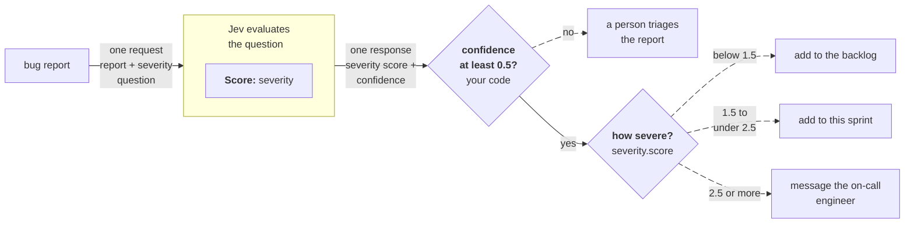

> ## Documentation Index
> Fetch the complete documentation index at: https://docs.typesafe.ai/llms.txt
> Use this file to discover all available pages before exploring further.

# Routing by confidence

> Use confidence as a second axis. The score tells you what; confidence tells you whether to act on it.

A Score answer gives you a position on the scale, `score`, and a [confidence](https://docs.typesafe.ai/confidence.md) from 0 to 1 that says how certain the answer is. Check the confidence first: send an answer whose probability is spread across the scale to a person, and route the rest on the score.

## Example: triaging bug reports

Let's imagine you are building a bug tracker that triages incoming reports. A cosmetic issue can wait in the backlog, a broken feature goes into the current sprint, and anything that stops users completing a core task goes straight to the on-call engineer. A report that doesn't make its severity clear should go to a person before anyone messages the engineer.



### Score how severe the report is

Send the report with one Score question. Its five levels run from a cosmetic issue to a critical one.

Try it in the Playground →

Jev's answer doesn't say whether the update lost the notes or the user deleted them:

```json theme={null}
{
  "model": "jev-1.14.0",
  "answers": {
    "severity": {
      "type": "score",
      "score": 3.19,
      "confidence": 0.34,
      "legend": {
        "0": "Cosmetic: wording, layout, or styling only",
        "1": "Minor: something misbehaves, but users can still do what they wanted",
        "2": "Major with a workaround: a feature is broken, but there is another way to get the job done",
        "3": "Major with no workaround: users cannot complete a core task",
        "4": "Critical: data loss, a security hole, or the product is down for everyone"
      },
      "probabilities": {
        "0": 0.01,
        "1": 0.14,
        "2": 0.07,
        "3": 0.19,
        "4": 0.59
      }
    }
  },
  "usage": {
    "input_tokens": 435,
    "output_tokens": 17
  }
}
```

A score of 3.19 on its own would message the on-call engineer. The probabilities tell a different story: most of the probability is on "critical", in case the update lost the notes, but 0.14 is on "minor", in case the user deleted them. The probability spread brings the confidence down to 0.34.

### Send unsettled scores to a person, route the rest

Check confidence before reading the score, and route on the score only when the check passes.

```python theme={null}
severity = response.answers["severity"]

if severity.confidence < 0.5:
    # The probability is spread across the scale. A person reads the report first.
    send_to_triage(report_id)

elif severity.score < 1.5:
    add_to_backlog(report_id)

elif severity.score < 2.5:
    add_to_sprint(report_id)

else:
    message_on_call(report_id)
```

The "Notes gone?" report goes to triage, where a person can ask the reporter whether the notes were deleted. Reports with a clear severity route straight through, as these recorded `jev-1.14.0` answers show:

| Report | `score` | `confidence` | Outcome |
| - | - | - | - |
| Typo on the settings page | 0.0 | 1.0 | backlog |
| PDF export fails over 50 pages; splitting the document works | 2.0 | 1.0 | this sprint |
| Checkout returns a 500 error for every customer | 3.36 | 0.7 | message on-call |
| Notes gone after the update, or maybe deleted | 3.19 | 0.34 | triage |

## When two levels split the answer

For a Score, if two levels have the highest and equal probabilities, the score is much higher if those two levels are next to each other than if they are not. The further they are apart, the lower the score.
A Score's confidence counts probability on a neighboring level as only a small spread. That can be an issue if you set a threshold between those two levels: an answer split between them can pass a confidence check and land on the wrong side of the threshold. The [Score explorer](https://docs.typesafe.ai/confidence.md#score) shows how the distance between levels changes confidence.

When a decision depends on which side of a level boundary the answer falls, add up the probabilities of the levels on the side that matters:

```python theme={null}
blocked = severity.probabilities[3] + severity.probabilities[4]

if blocked >= 0.3:
    # A real chance users are blocked. Message someone rather than wait for the sprint.
    message_on_call(report_id)
```

[Routing by probability](https://docs.typesafe.ai/patterns/probability-routing.md) builds a whole router on probabilities like this, with a separate threshold for each action.


This documentation is built and hosted on [Mintlify](https://mintlify.com), a developer documentation platform.