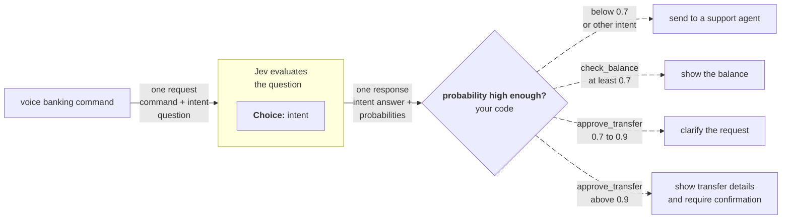

> ## Documentation Index
> Fetch the complete documentation index at: https://docs.typesafe.ai/llms.txt
> Use this file to discover all available pages before exploring further.

# Routing by probability

> Give riskier actions a higher probability threshold. The answer says what to do, and its probability says whether to do it.

Every Jev answer comes with [probabilities](https://docs.typesafe.ai/confidence.md). For each action your code can take, decide how high the probability must be before you take it. Riskier actions get higher thresholds, and an answer below the threshold gets its own outcome, such as asking the user to clarify, instead of counting as a yes. The actions can be anything your code can call: a function in your app, an LLM, or a person.

## Example: acting on voice banking commands

Say you're building a voice banking interface where users manage their account by speaking. Before acting on a command, you want to be reasonably sure what the user asked for, and very sure for the riskier actions.



### Ask what the user wants to do

Send the user's command with one Choice question. The `other` option catches commands this system doesn't handle. It keeps the example short, but a [companion Noul](https://docs.typesafe.ai/patterns/companion-noul.md#why-an-other-option-falls-short) usually works better as a catch-all.

Try it in the Playground →

Jev's response:

```json theme={null}
{
  "model": "jev-1.14.0",
  "answers": {
    "intent": {
      "type": "choice",
      "choice": "check_balance",
      "confidence": 1.0,
      "probabilities": {
        "check_balance": 1.0,
        "approve_transfer": 0.0,
        "other": 0.0
      }
    }
  },
  "usage": {
    "input_tokens": 343,
    "output_tokens": 41
  }
}
```

### Set a threshold for each action

Compare the probability of the chosen option, `probabilities[choice]`, against the threshold. That number is how likely it is that this option is what the user asked for.

```python theme={null}
action = response.answers["intent"]
likelihood = action.probabilities[action.choice]

# Below 0.7 on any action, the command didn't settle the intent. Route to a human.
if likelihood < 0.7:
    route_to_support_agent(account_id)

elif action.choice == "check_balance":
    # Low stakes. 0.7 is sufficient.
    show_balance(account_id)

elif action.choice == "approve_transfer":
    if likelihood > 0.9:
        # Identifying the intent starts confirmation; it does not approve a transfer.
        show_transfer_for_confirmation(account_id)
    else:
        # Clarify what the user wants before opening the transfer workflow.
        ask_user_to_clarify("Would you like to review the pending transfer?")

else:
    route_to_support_agent(account_id)
```

The thresholds only choose which workflow runs; none of them moves money. A clear transfer request opens a confirmation screen with the amount and recipient, and the transfer runs only after the user confirms them. A less certain one asks the user what they meant first.

The confirmation step matters because a hesitant command can still have a clear intent. With `jev-1.14.0`, "Um, the transfer thing... yeah, go ahead I guess." got 0.99 for `approve_transfer`. That answer says which action the user wants, but not that the user has checked the transfer details.

> [!NOTE]
>
> **Why not `confidence`?** For a Choice question with a fixed number of options, `confidence` is calculated from the top probability, so a threshold on it adds nothing, and the probability is easier to read as risk. If it matters how the other options compare, check their probabilities too. Confidence is more useful for a Score, as in [Routing by confidence](https://docs.typesafe.ai/patterns/confidence-routing.md). Also take a look at [When to act on confidence](https://docs.typesafe.ai/confidence.md#when-to-act-on-confidence).


This documentation is built and hosted on [Mintlify](https://mintlify.com), a developer documentation platform.